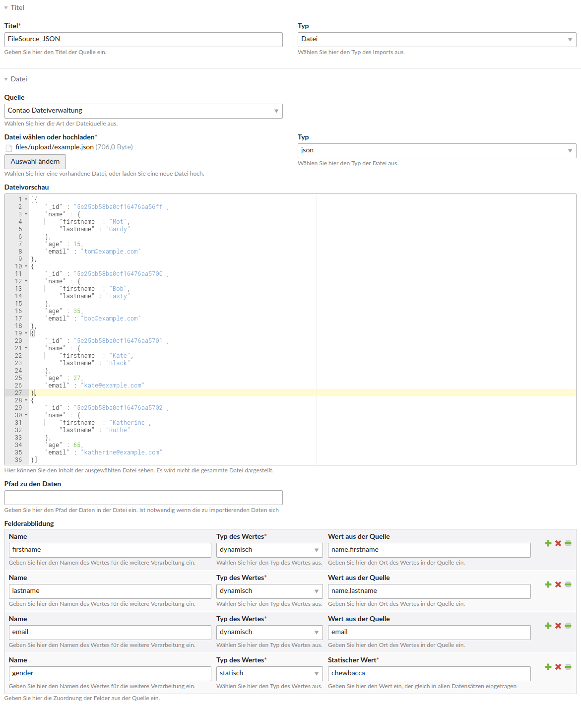
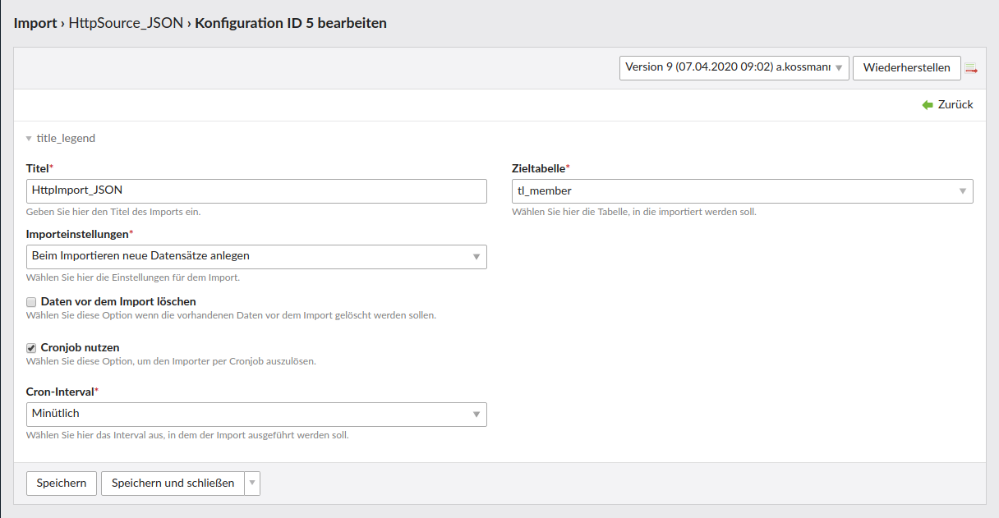
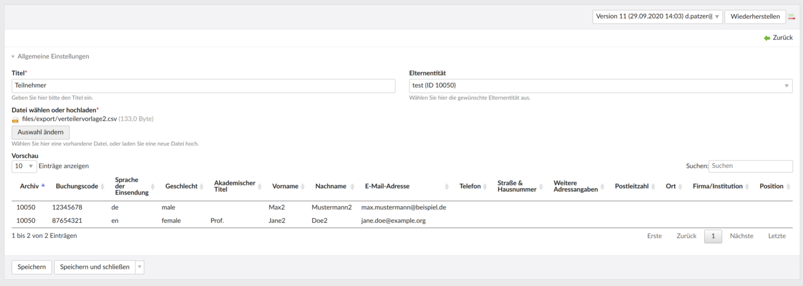

# Contao Entity Import Bundle

This bundle offers a generic importer to migrate data from various sources to contao database entities.

**This Bundle is still in development.**

## Features

- import data from either file content or database into arbitrary contao database entities (`tl_*`)
- support for various data types (json, csv, ...)
- support for various source types (contao file system, http, absolute path)
- social media sources: Instagram, Facebook pages, YouTube channels and LinkedIn company pages, with access token
  login and refresh in the back end
- executable from contao backend, as cronjob and symfony command
- automatic field manipulation (sorting, alias, dateAdded, tstamp)
- merge and insert mode
- email and contao_log notifications while executing import with exceptions (will be sent once per importer 
configuration, will be reset after next successful import)
- (optional) support for [DC_Multilingual](https://github.com/terminal42/contao-DC_Multilingual) if installed

## Impressions

Importer source backend settings:



Importer config backend settings:



## Installation

Install via composer: `composer require heimrichhannot/contao-entity-import-bundle` and update your database.

## Configuration

1. Navigate to "Import" in the Contao backend in the section "system".
1. Create an importer source to your needs.
1. Create an importer using the source created in the step before.
1. Run the importer either using dry-run or the normal mode.

### config.yml

```yaml
huh_entity_import:
  debug:
    contao_log: true # log errors while importing to contao system log
    email: false # report errors while importing via email to the admin email defined in the contao settings
```

## Social media sources

Besides databases and files, an import source can read the posts of a social media account. Each source type has a
fixed set of source fields; the field mapping offers them in a select (Instagram: type the field name).

| Type | Platform API | Credentials | Token lifetime |
|---|---|---|---|
| `instagram` (Instagram Login) | Instagram API with Instagram Login (graph.instagram.com) | access token | 60 days, refreshed automatically |
| `instagram` (Facebook Login) | Instagram API with Facebook Login (graph.facebook.com) | Meta app, page token via login | does not expire |
| `facebook` | Graph API `/{page-id}/posts` | Meta app, page token via login | does not expire |
| `youtube` | YouTube Data API v3 | API key | – |
| `linkedin` | Posts API of LinkedIn's Community Management API | LinkedIn app, token via login | 60 days, refreshed for a year |

Answers of the APIs are cached for 5 minutes. Errors show up as back end messages with the API's error message
(never with the request URL, which may contain the token).

### Access tokens

- **Request access token** (Facebook, Instagram with Facebook Login, LinkedIn): save the app credentials first, then
  click the button. You log in with the platform, grant the app access and return to the import source with the token
  stored. The help text below the button shows the redirect URL to enter in the app's settings. The redirect URLs are
  the ones contao-newsroom-bundle used (`/contao-newsroom/facebook/{id}/redirect_callback`,
  `/contao-newsroom/auth/linkedin`), so apps set up for it keep working.
- **Refresh access token now** (Instagram with Instagram Login, LinkedIn with a refresh token): tick the checkbox and
  the source is saved and its token exchanged for a new one with the full lifetime right away.
- A **daily cron job** (`AccessTokenRefreshCron`) refreshes those tokens 30 days before they expire (or when the expiry
  is unknown). Failures go to the Contao system log. For LinkedIn it also logs an error every day during the last 30
  days of the refresh token, since only a new login helps then.

### Instagram

- **Instagram API with Instagram Login**: for Instagram professional (business or creator) accounts. Generate a token
  for the account in the Meta app's dashboard (Instagram > API setup with Instagram login) and paste it. Graph API version: e.g. `v24.0`. Instagram allows a refresh once a token is at
  least 24 hours old.
- **Instagram API with Facebook Login**: for Instagram professional accounts connected to a Facebook page. Enter the
  Meta app's ID and secret and the Graph API version, request the access token and log in with an account that manages
  the page. The token of the page connected to the Instagram account is stored; if several of your pages have one,
  enter the Instagram user ID first (the error message lists them).
- Source fields: `id`, `caption`, `media_type`, `media_url` (the thumbnail for videos), `thumbnail_url`, `permalink`,
  `timestamp` (Unix time), `username`. Posts not shown in the profile's feed are skipped.

### Facebook pages

1. Create a Meta app (developers.facebook.com) that uses Facebook Login and may ask for the permissions
   `pages_show_list` and `pages_read_engagement` (the login passes them as `scope`). Add the redirect URL shown below
   the "Request access token" button as "Valid OAuth Redirect URI".
1. As long as the account that logs in has a role on the app (administrator, developer or tester), standard access to
   these permissions suffices and no App Review is needed.
1. Enter app ID, app secret, Graph API version (e.g. `v24.0`) and, if you manage more than one page, the page ID; save
   and request the access token.

The page token does not expire, but stops working if the account that logged in loses its role on the page, changes
its password or removes the app; request a new one then.

Source fields: `id`, `message`, `full_picture`, `permalink_url`, `created_time` (Unix time), `status_type`.

### YouTube

Create an API key for the YouTube Data API v3 in the Google Cloud console. Find the channel by its ID (`UC…`), its
handle (`@name`) or, for old channels, its user name. The source reads the latest 50 public videos from the channel's
uploads playlist: 2 of the 10,000 daily quota units per import.

Source fields: `id`, `title`, `description` (characters beyond ASCII as numeric entities), `publishedAt` (Unix time),
`channelId`, `channelTitle`, `image_url` (the largest thumbnail), `url`.

### LinkedIn company pages

Reading an organization's posts needs LinkedIn's **Community Management API**, which LinkedIn grants after reviewing
the app and verifying the company (developer.linkedin.com > your app > Products). Without it the login fails with an
unauthorized scope.

1. In the app's "Auth" tab, add the redirect URL shown below the "Request access token" button.
1. Enter client ID and secret, the organization ID (the number in the page's admin URL), the API version (`YYYYMM`;
   LinkedIn supports each version for at least a year) and the number of posts; save and request the access token
   with an account that administers the page.
1. Access tokens last 60 days. Apps with programmatic refresh tokens also get a refresh token that lasts a year from
   the login, and the token is refreshed automatically until then.

Source fields: `id` (the post URN), `url`, `commentary` (plain text: mentions as names, hashtags as `#tag`),
`publishedAt` (Unix time), `image_url` (image or video thumbnail; only requested if mapped), `article_url`,
`article_title`. Drafts and sponsored posts that are not shown in the feed are skipped.

To store images, map `image_url` (or `media_url`, `full_picture`) to a file field in the importer's file field mapping.

### Platforms not supported

X (Twitter), which contao-newsroom-bundle supported, is not: reading timelines needs paid API access.

## Technical instructions

### Output messages during import process respecting the context

An importer can be run as command, cronjob or in the web context. The context implies how to output messages (or error messages).

For example, when running an importer by clicking the "import" button in the website (i.e. in the browser), the messages should be
printed out using `\Contao\Message::addError()` (or `addConfirmation()`, ...). If the import is run as command, the same messages
need to be printed out on command line using a `SymfonyStyle` instance. If the command is also run in web context, the messages even
need to be stored to the `tl_entity_import_config` entity, because these are retrieved by ajax in the progress bar view.

As you can see, it's not just "printing a message", but taking care of the context, as well.

For this you can use the method `ImporterInterface::outputResultMessage()` which takes care of the correct context itself.

### Run as symfony command

`huh:entity-import:execute config-ids [--dry-run]`

where `config-ids` needs to be a comma separated list of importer config IDs.

##### Arguments
Argument | Mandatory | Type | Description
--------|--------|-------|---
config-id | true | integer |The ID of the importer configuration
dry-run | false | boolean |Run importer without writing data into database

### Run as contao cron

Import is executable with contao poor man's cron. The interval of execution is similar to the contao definition.
The import configuration allows to enable cron execution and picking of the cron interval.
Possible to choose between `minutely`, `hourly`, `daily`, `weekly`, `monthly` interval. It is recommended to setup
the debug options in config.yml before importing via cronjob.

### Add custom sources

1. Create the source and extend from `\HeimrichHannot\EntityImportBundle\Source\AbstractSource` or implement the
   interface `\HeimrichHannot\EntityImportBundle\Source\SourceInterface`.
1. Create an event listener for the event `SourceFactoryCreateSourceEvent`:
   ```php
   class SourceFactoryCreateSourceEventListener {
       public function __invoke(SourceFactoryCreateSourceEvent $event) {
           $sourceModel = $event->getSourceModel();
           $source = $event->getSource();
   
           switch ($sourceModel->type) {
               case 'new_stuff':
                   $source = new NewStuffSource();
   
                   break;
               // ...
           }
   
           $event->setSource($source);
       }
   }
   ```
1. Create a `tl_entity_import_source.php` and add your sources in the `type` field's options:
   ```php
   $dca = &$GLOBALS['TL_DCA']['tl_entity_import_source'];
   
   $dca['fields']['type']['options'] = array_merge($dca['fields']['type']['options'], [
       'new_stuff'
   ]);
   ```
1. Create your palette in your `tl_entity_import_source.php`, e.g. by copying one from this bundle.

### Add presets for source/config field mapping

Adding a field mapping might be tedious sometimes. Hence we provide an event for adding presets which then are selectable in the backend entity (source and config).

Just register an event listener and add your presets the following way:

```
$presets = $event->getPresets();

$presets = array_merge($presets, [
    'twitter' => [
        [
            'name'        => 'externalId',
            'valueType'   => 'source_value',
            'sourceValue' => 'id',
        ],
        [
            'name'        => 'text',
            'valueType'   => 'source_value',
            'sourceValue' => 'full_text',
        ],
        [
            'name'        => 'publishedAt',
            'valueType'   => 'source_value',
            'sourceValue' => 'created_at',
        ],
        [
            'name'        => 'imageUrl',
            'valueType'   => 'source_value',
            'sourceValue' => 'image_url',
        ],
        [
            'name'        => 'imageId',
            'valueType'   => 'source_value',
            'sourceValue' => 'image_id',
        ],
        [
            'name'        => 'url',
            'valueType'   => 'source_value',
            'sourceValue' => 'url',
        ],
    ]
]);

$event->setPresets($presets);
```

### Add quick importers for editors

To be honest: A "quick importer" is a nicer term for "easy importer", so that editors don't get sad ;-) The use case for quick importers
is to have a user interface which is *way* easier to use for editors.

Simply create an import source and import config as you would normally. Afterwards editors can create quick importers on their own
and add custom file sources (currently only files of the type CSV are supported).



### Run the import via cronjob in web context

If you have large datasets the import might take too much memory of the web server. In this case it's often useful to

1. Run the importer as symfony command. This has to be done by a developer.
2. Run the importer in the web context by cronjob. This can be done by editors or developers.

In most cases, running an importer by command on the shell takes way less memory compared to running it in the web context via website.

For option 2 to work you need to do the following steps:

1. Add the bundle's import command as cronjob using the parameter `--web-cron-mode`:<br>
   `* * * * * /path/to/vendor/bin/contao-console huh:entity-import:execute <import config ids> --web-cron-mode >/dev/null 2>&1`
2. Activate `useCron` in the importer config and fill out the needed fields.
3. Activate `useCronInWebContext` in the importer config.

## Events

Name | Description
-----|------------
`AddConfigFieldMappingPresetsEvent` | Add config field mapping presets
`AddSourceFieldMappingPresetsEvent` | Add source field mapping presets
`AfterCsvFileSourceGetRowEvent` | Modify csv rows e.g. for fixing file encoding issues
`AfterFileSourceGetContentEvent` | Configure the data after receiving from source
`AfterImportEvent` | Get imported data after finished import
`AfterItemImportEvent` | Get imported item data after finished import
`BeforeAuthenticationEvent` | Configure authentication data before sending GET request to http source
`BeforeImportEvent` | Configure the data before importing
`BeforeItemImportEvent` | Configure the item data before importing; call `setSkipped(true)` in order to skip the import
`SourceFactoryCreateSourceEvent` | Implement custom logic for new custom file sources
`BeforeFileImportEvent` | Implement a custom logic for setting the folder and/or file path when importing files

## Development

Run the tests:

```bash
composer install
vendor/bin/phpunit
```

The tests of the social media sources run against a mocked HTTP client; they need no credentials.
